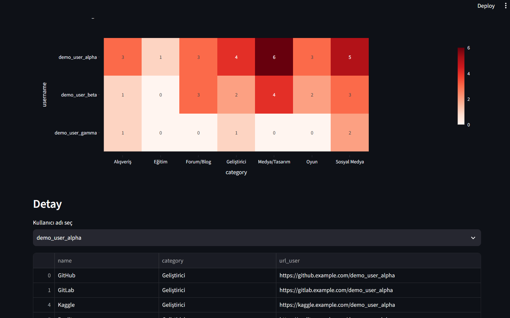
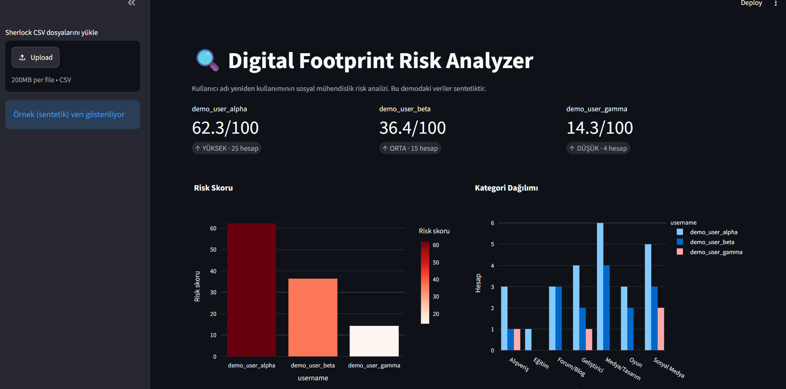
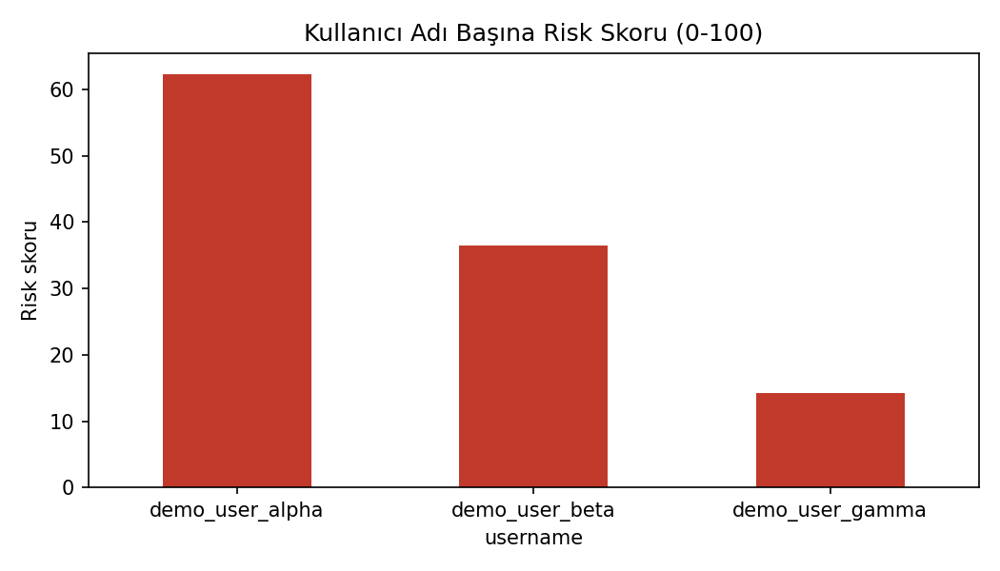
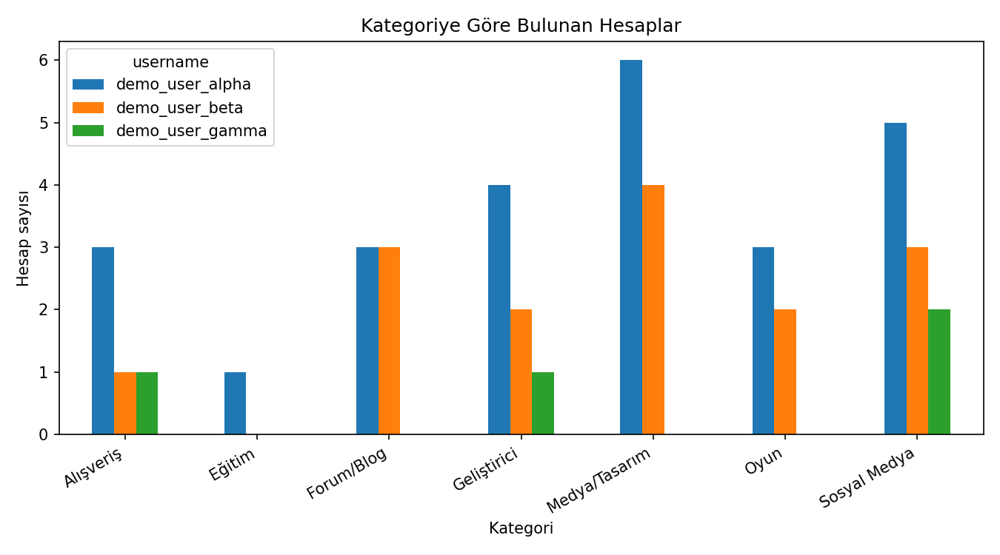
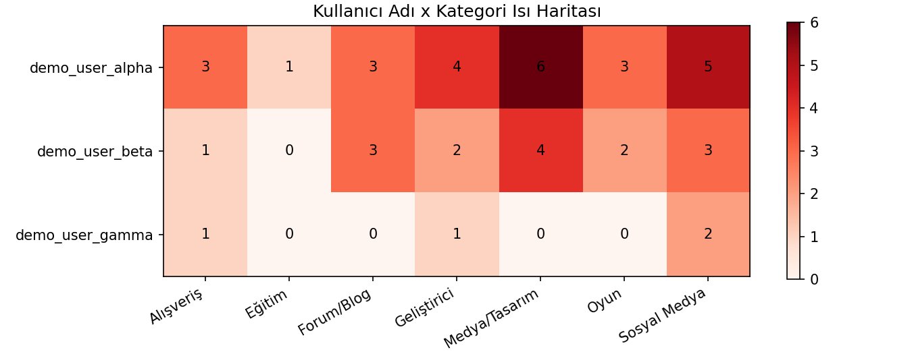

# 🔍 Digital Footprint Risk Analyzer

Kullanıcı adı yeniden kullanımının **sosyal mühendislik saldırı yüzeyini** nasıl büyüttüğünü ölçen, [Sherlock](https://github.com/sherlock-project/sherlock) çıktısını analiz eden bir farkındalık ve veri analizi prototipi.

> ⚠️ **Bu repodaki tüm veriler sentetiktir.** Gerçek kişilere ait hiçbir veri içermez. Araç, mantığını göstermek için `example.com` adresleriyle üretilmiş sahte Sherlock çıktıları kullanır.

## Neden bu proje?

Sosyal mühendislik saldırılarının ilk adımı çoğu zaman OSINT (açık kaynak istihbaratı) olur. Aynı kullanıcı adını onlarca platformda kullanmak, saldırgana hedef hakkında profil çıkarma imkânı verir. Bu proje şu soruya yanıt arar: **"Bir kullanıcı adı ne kadar iz bırakıyor ve bu iz ne kadar riskli?"**

## Özellikler

- Sherlock CSV çıktılarını okur ve temizler
- Platformları kategorilere ayırır (Sosyal Medya, Geliştirici, Forum/Blog, Medya/Tasarım, Oyun, Alışveriş, Eğitim)
- Her kullanıcı adı için **0-100 arası risk skoru** ve seviye (DÜŞÜK / ORTA / YÜKSEK) hesaplar
- Kategori dağılımı, ısı haritası ve skor grafikleri üretir
- Etkileşimli **Streamlit dashboard**: kendi Sherlock CSV dosyalarını yükle, analiz et, raporu indir
- Kişiselleştirilmiş savunma önerileri

## Ekran görüntüleri

### Dashboard




### Analiz grafikleri
| Risk skoru | Kategori dağılımı |
|---|---|
|  |  |



## Örnek sonuç (sentetik veri)

| Kullanıcı adı | Bulunan hesap | Risk skoru | Seviye |
|---|---|---|---|
| demo_user_alpha | 25 | 62.3 | YÜKSEK |
| demo_user_beta | 15 | 36.4 | ORTA |
| demo_user_gamma | 4 | 14.3 | DÜŞÜK |

## Kurulum

```bash
git clone https://github.com/sumeyye-s3/digital-footprint-analyzer.git
cd digital-footprint-analyzer

python -m venv venv
# Windows:
venv\Scripts\activate
# Mac/Linux:
source venv/bin/activate

pip install -r requirements.txt
```

## Kullanım

**1. Örnek veri üret (isteğe bağlı)**
```bash
python src/generate_sample_data.py
```

**2. Analizi çalıştır ve grafikleri üret**
```bash
python src/risk_analysis.py
```

**3. Dashboard'u aç**
```bash
streamlit run app.py
```
Tarayıcıda `http://localhost:8501` adresi açılır.

**4. Kendi verinle kullan**
Sadece **kendi** kullanıcı adını Sherlock ile tara:
```bash
sherlock kullaniciadi --csv --print-found --timeout 10
```
Çıkan CSV dosyasını dashboard'daki yükleme alanına bırak. Veri yalnızca kendi bilgisayarında işlenir.

ℹ️ Dashboard herkese açık bir web sitesi değil, yerel olarak çalışır. 
 `streamlit run app.py` komutundan sonra kendi bilgisayarında `http://localhost:8501` adresinde açılır.
Bu tasarım bilinçlidir: kendi kullanıcı adı verilerin hiçbir sunucuya gönderilmez.

## Proje yapısı

```
digital-footprint-analyzer/
├── data/                      # Sentetik örnek CSV dosyaları
├── reports/                   # Grafikler ve ekran görüntüleri
├── src/
│   ├── generate_sample_data.py   # Sahte Sherlock çıktısı üretici
│   ├── analyze.py                # Veri yükleme
│   └── risk_analysis.py          # Kategori, skor, grafikler
├── app.py                     # Streamlit dashboard
├── requirements.txt
└── README.md
```

## Risk skoru metodolojisi

Her platform kategorisine, sosyal mühendislik açısından bir ağırlık atanmıştır:

| Kategori | Ağırlık | Gerekçe |
|---|---|---|
| Sosyal Medya | 3 | Kişisel bilgi ve sosyal çevre yoğun |
| Alışveriş | 3 | Finansal ve adres bilgisi, güven ilişkisi |
| Geliştirici | 2 | Meslek ve iletişim bilgisi |
| Forum/Blog | 2 | Yazı stili, ilgi alanları |
| Oyun, Medya/Tasarım, Eğitim | 1 | Daha sınırlı kişisel veri |

```
Risk skoru = (bulunan hesapların ağırlık toplamı / tüm platformların ağırlık toplamı) × 100
```

Seviyeler: **YÜKSEK** ≥ 60, **ORTA** ≥ 30, **DÜŞÜK** < 30.

Bu ağırlıklar **bir metodoloji tercihidir, bilimsel bir standart değildir.** `src/risk_analysis.py` içindeki `WEIGHTS` sözlüğünden değiştirilebilir.

## Sınırlamalar

- **Sentetik veri:** Gösterilen sonuçlar gerçek bir kişiyi temsil etmez.
- **Yanlış pozitifler:** Sherlock bazı sitelerde, hesap olmasa bile "var" sonucu verebilir. Gerçek veride skorlar şişebilir.
- **Kimlik doğrulaması yok:** "Hesap var" sonucu, hesabın size ait olduğunu göstermez; başka biri aynı adı almış olabilir.
- **Dar kapsam:** Yalnızca kullanıcı adı yeniden kullanımını ölçer. E-posta sızıntıları, şifre tekrarı ve profil içeriği kapsam dışıdır.
- **Platform listesi:** Kategori sözlüğü örnek platformları kapsar; bilinmeyen platformlar "Diğer" olarak ağırlık 1 alır.

## Etik kullanım

Bu araç **savunma ve farkındalık** amacıyla geliştirilmiştir.

- Yalnızca **kendi** kullanıcı adlarını veya **açık izin** aldığın verileri analiz et.
- Başkalarını izinsiz taramak etik ve hukuki sorunlar doğurabilir.
- Gerçek kişisel verileri herkese açık repolara yükleme.

## Savunma önerileri

- Farklı platformlarda farklı kullanıcı adları kullan
- Herkese açık profil bilgilerini azalt
- E-posta takma adları (alias) kullan
- Kullanılmayan eski hesapları sil
- Tüm hesaplarda iki adımlı doğrulamayı aç

## Kullanılan teknolojiler

Python · pandas · matplotlib · Plotly · Streamlit · Sherlock

## Yol haritası

- [ ] Daha geniş platform kategori sözlüğü
- [ ] Yanlış pozitif tespiti (yanıt boyutu / durum kodu analizi)
- [ ] PDF rapor çıktısı
- [ ] Zaman içindeki ayak izi değişimi

## Lisans

MIT

## Yazar

[Sümeyye](https://github.com/sumeyye-s3)
